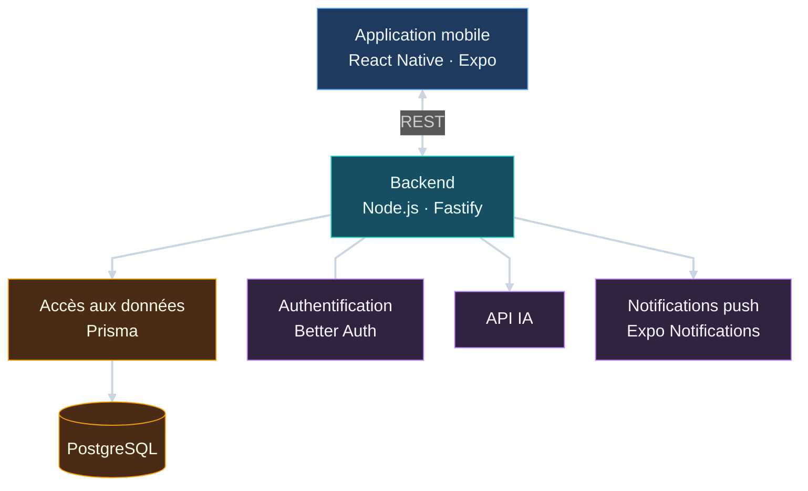
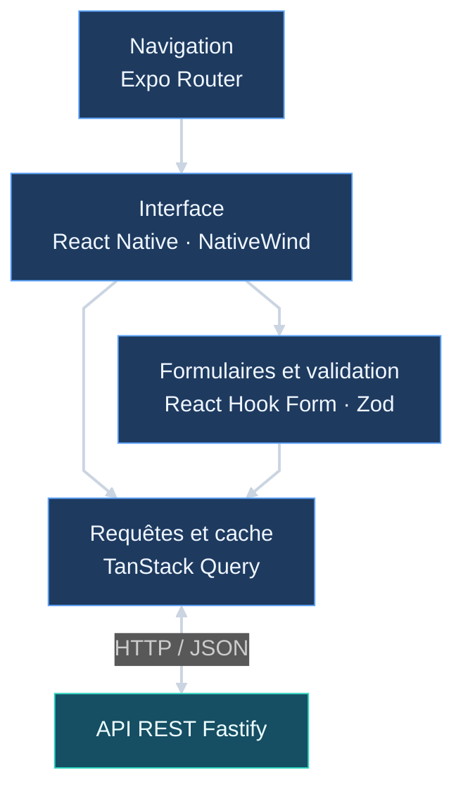
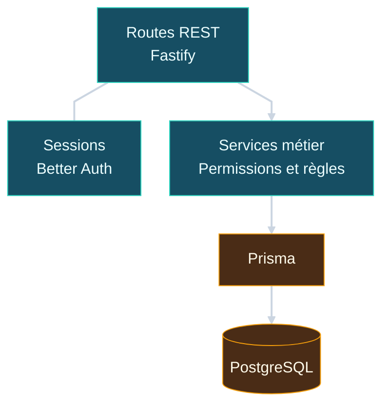
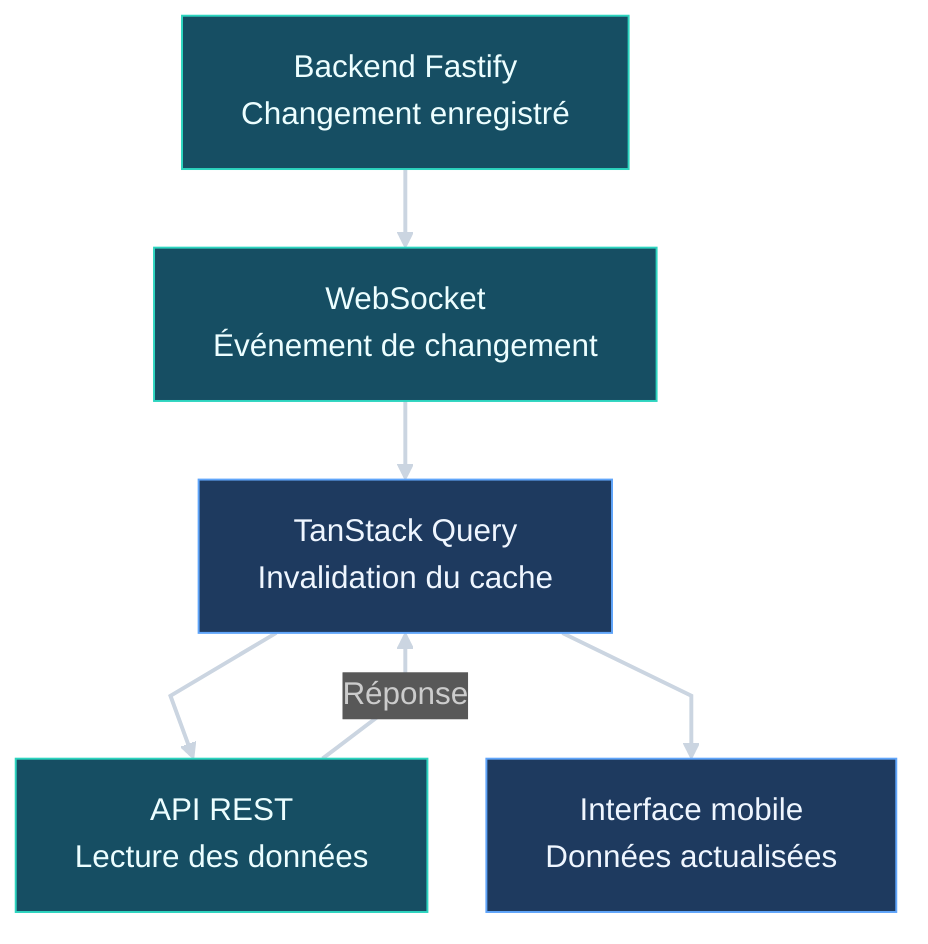
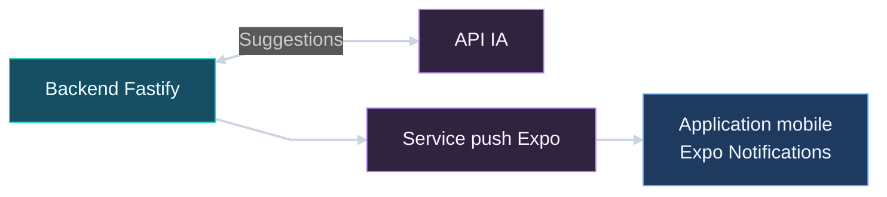

# Stack technique — ColocSync

## Stack

| Couche | Technologies | Rôle |
|---|---|---|
| Application mobile | React Native · Expo | Application Android et iOS |
| Navigation et interface | Expo Router · NativeWind | Écrans, navigation et styles |
| Formulaires | React Hook Form · Zod | Saisie et validation |
| Données côté client | TanStack Query | Requêtes, mutations et cache |
| Backend | Node.js · Fastify | API REST et services métier |
| Authentification | Better Auth | Comptes et sessions |
| Persistance | Prisma · PostgreSQL | Accès typé, migrations et stockage |
| Temps réel | WebSocket | Diffusion des changements |
| Notifications | Expo Notifications | Notifications push |
| Intelligence artificielle | API IA | Suggestions via le backend |
| Langage | TypeScript | Typage du mobile et du backend |
| Développement | Docker · Git · GitHub | Environnement local et versionnement |

## Architecture générale

## Application mobile

## Backend et données

## Synchronisation temps réel

**REST** gère les lectures et les écritures. **WebSocket** signale les changements après leur enregistrement ; **TanStack Query** recharge les données concernées.

## Services complémentaires

